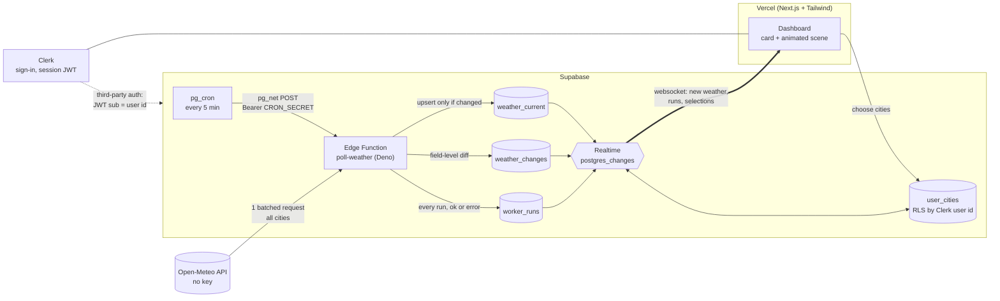

# Skyline — live weather, drawn as your city

Pick the cities you care about and watch their live weather unfold in an animated skyline. A Supabase edge function polls [Open-Meteo](https://open-meteo.com) (no API key needed) every five minutes, records what changed, and Supabase Realtime pushes the new data to every open browser. No refresh needed.

Launch cities with hand-drawn, interactive scenes: **Chicago, New York, San Francisco, London, Tokyo, Singapore**. Every other city gets a standard animated skyline with the same live weather.

## How it works



1. **Cron** (`pg_cron`) calls the edge function every 5 minutes through `pg_net`, authenticated with a shared secret kept in Supabase Vault.
2. **Worker** (`supabase/functions/poll-weather`) fetches all cities from Open-Meteo in a single call (with retries), compares each city to its stored row, writes only what changed, logs the diff, and records the run — including failures.
3. **Realtime** broadcasts row changes. The browser also refetches whenever the socket reconnects, so a laptop that slept never shows silently wrong data.
4. **Clerk** handles sign-in. Its session token doubles as the Supabase JWT, so row level security restricts `user_cities` to the signed-in user, for both queries and realtime.

### Data freshness states

The UI derives freshness from `worker_runs`, not from guesses. The worker runs every 5 minutes (`WORKER_INTERVAL_MS` in [`src/lib/freshness.ts`](src/lib/freshness.ts)).

| State | When | What you see |
|---|---|---|
| **Loading** | first fetch in flight | pulsing grey badge, skeleton card |
| **Waiting** | worker has never succeeded | "Waiting for the first worker run" |
| **Fresh** | last success ≤ 7.5 min ago | green "Live · updated 42s ago" |
| **Stale** | 1–2 runs missed | amber "Delayed" banner on the card |
| **Out of date** | 3+ runs missed | orange banner, card dimmed |
| **Failed** | the latest run errored | red banner with the error and the age of the data still shown |

The badge opens a panel with the last success, last failure, missed runs and realtime connection status.

### Scenes and interactions

Click anywhere (or on the landmark where noted). Use **Try weather** in the top bar, or [`/preview`](http://localhost:3000/preview), to see any weather in any city.

| Weather | Scene | Interaction |
|---|---|---|
| Sunny | smiling sun whose eyes follow your cursor | click: the sun focuses a beam on the landmark, which heats up for a few seconds, then the sun giggles |
| Clear night | sleepy moon, twinkling stars | click: the moon winks and a shooting star crosses |
| Rain / drizzle | gloomy sky, falling rain, people with umbrellas | click the landmark: a sprout grows there; click elsewhere: splashes |
| Snow | everything capped in snow, people with hot chocolate | click the landmark: it shakes off snow and shivers |
| Thunderstorm | dark sky, random lightning | click: lightning strikes where you click |
| Tornado | funnel with orbiting debris (thunderstorm with gusts ≥ 90 km/h) | click: it travels to you; otherwise it wanders |
| Fog | drifting mist | the mist parts around your cursor |
| Cloudy / partly cloudy | drifting clouds | click: a cloud squishes and sprinkles |

## Project layout

```
supabase/
  migrations/      schema + RLS + realtime publication; pg_cron schedule
  functions/poll-weather/
    index.ts       Deno entrypoint: auth, fetch, write, record run
    logic.ts       pure parse/diff helpers (unit tested)
src/
  app/             Next.js app router (Clerk in the (app) group, public /preview)
  components/      Dashboard, WeatherCard, FreshnessBadge, CityPicker
  components/scene/  Stage, Sky, particles, effects, and cities/<city>.tsx skylines
  hooks/useLiveWeather.ts   data load + realtime subscriptions
  lib/             freshness logic, weather-code mapping, Supabase client
tests/             unit tests (npm test)
```

`tsconfig.json` excludes `supabase/` so `next build` doesn't type-check the Deno worker.

## Setup

You need a Supabase project, a Clerk application and a Vercel account.

### 1. Supabase

```bash
npm install
npx supabase login
npx supabase link --project-ref <your-project-ref>
npx supabase db push
```

Create the two Vault secrets the cron job reads (SQL editor). Pick any long random string for `cron_secret`:

```sql
select vault.create_secret('https://<your-project-ref>.supabase.co', 'project_url');
select vault.create_secret('<long-random-string>', 'cron_secret');
```

Deploy the worker with the same secret:

```bash
npx supabase secrets set CRON_SECRET=<long-random-string>
npx supabase functions deploy poll-weather
```

Run it once by hand to check (it should return `{"ok":true,...}`), then watch `worker_runs` fill up every five minutes:

```bash
curl -X POST https://<your-project-ref>.supabase.co/functions/v1/poll-weather \
  -H "Authorization: Bearer <long-random-string>"
```

### 2. Clerk ↔ Supabase

1. In Clerk, open **Configure → Integrations → Supabase** (or "Connect with Supabase") and activate it. This adds the `role: authenticated` claim to session tokens.
2. In Supabase, open **Authentication → Sign In / Providers → Third-Party Auth**, add **Clerk**, and paste your Clerk domain.

### 3. Environment variables

```bash
cp .env.example .env.local   # fill in the four values
npm run dev
```

| Variable | Where to find it |
|---|---|
| `NEXT_PUBLIC_CLERK_PUBLISHABLE_KEY`, `CLERK_SECRET_KEY` | Clerk → API keys |
| `NEXT_PUBLIC_SUPABASE_URL`, `NEXT_PUBLIC_SUPABASE_ANON_KEY` | Supabase → Project Settings → API |

### 4. Deploy on Vercel

Import the repository in Vercel, add the same four variables, and deploy. Add your Vercel domain to the allowed origins in Clerk if prompted.

## Development

```bash
npm run dev      # app on http://localhost:3000, scene playground at /preview
npm test         # worker diff logic + freshness states
npm run lint
npm run build
```

Data: weather by [Open-Meteo](https://open-meteo.com/) (CC BY 4.0).
